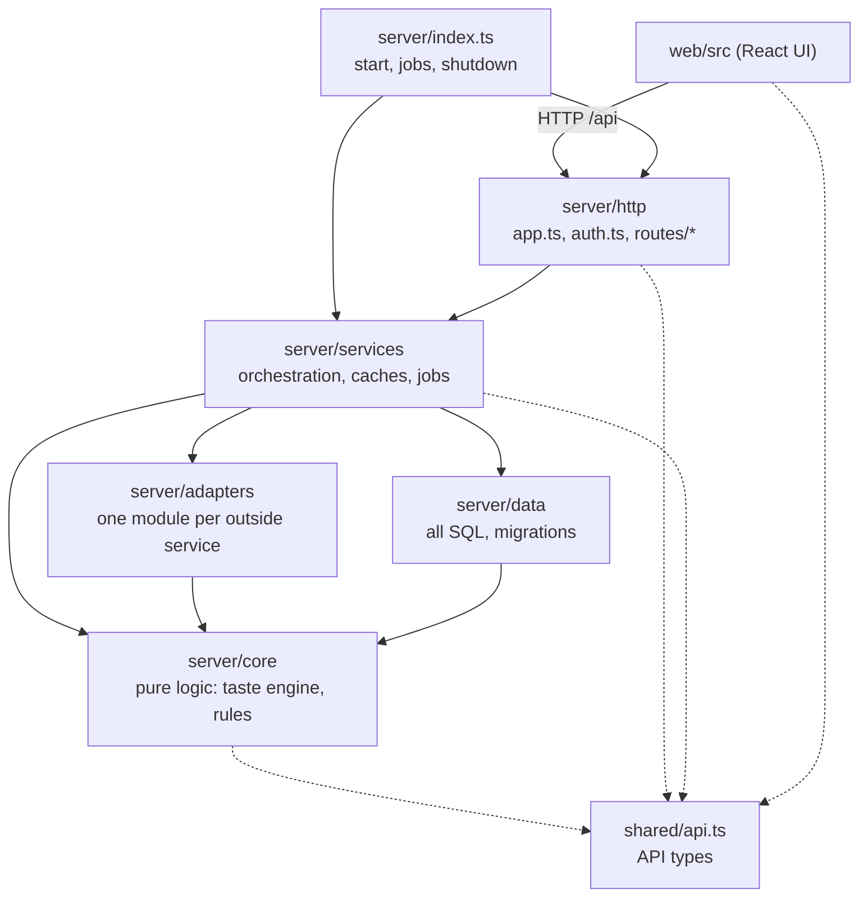

# Architecture

Tastearr is one Node process: a Fastify server with an SQLite database, background timers, and a React UI it serves as
static files. The server is split into five layers, and the web UI is split by feature. CI checks the layer rules
(`npm run depcheck`), lint, formatting and file size (`npm run lint`) on every push.

## Layer rules

| Layer | Holds | May import |
| --- | --- | --- |
| `shared/` | Request and response types of the HTTP API. Types only. | nothing |
| `server/core/` | Pure logic over plain data: the taste engine (`core/taste/`), settings validation, outbound URL check, ID mapping tables, Sonarr add rules, auto-add selection, alert wording. No database, network or file access and no module-level state (it may read the current date). | `core/`, `shared/`, `node:net`, `node:crypto`, `node:util` |
| `server/adapters/` | One module per outside service: AniList, Sonarr, Radarr (`arr.ts` is their shared client), Plex, Jellyfin, MyAnimeList, the anime ID list, ntfy/Gotify/Discord, appdata/Docker discovery. Each function takes its address and key as arguments and calls `checkOutbound` before sending anything. | `core/`, `config.ts` |
| `server/data/` | Every SQL statement, one module per table or area, plus the connection, migrations and `transaction()`. | `core/` (types), `config.ts` |
| `server/services/` | Orchestration: reads settings, calls adapters and data, runs core logic, owns caches and background jobs. | `core/`, `adapters/`, `data/`, other services |
| `server/http/` | `app.ts` builds Fastify and registers the route modules; `auth.ts` is the request guard; `routes/*` validate input, call a service and shape the response. | `services/`, `core/` |
| `web/src/` | The UI, one folder per page area (`picks/`, `settings/`, `shows/`, ...), shared pieces in `components/`, `hooks/`, `lib/`. | `shared/` (never `server/`) |

`server/config.ts` reads the environment once (config folder, port, paths). Also enforced: no import cycles anywhere, server files up to 400 lines and UI files up to 300 (blank lines and comments
not counted), Prettier formatting at 140 columns.

## Where things go

- **A new setting:** its type and default in `core/settings.ts` (and `PublicSettings` in `shared/api.ts` if the browser
  sees it), range or enum rules next to the others there.
- **A new call to an outside service:** a function in that service's adapter taking the connection as an argument. The
  service layer decides which connection and what to send.
- **A new table or query:** a migration appended to `data/db.ts` and functions in the matching `data/` module.
- **A taste or ranking change:** `core/taste/`, checked with `npm run eval` against real history before and after.
- **A new endpoint:** a route in the matching `http/routes/` module, with its response type in `shared/api.ts`. The
  route test (`test/routes.test.ts`) fails until it is guarded or explicitly listed as public.
- **A new background job:** `services/jobs.ts`, recording progress with `setJob` so it shows under System.

## Why it is built this way

1. **The taste engine is pure so it can move.** `core/taste/` takes a `Ctx` (what the user owns, watched, rated and
   listed), a `TasteConfig` and a media lookup, and returns profiles and scored picks. It never calls Sonarr or the
   database. The sister app AnimeArr can copy `core/taste/` and `shared/api.ts` as they are and write its own
   `services/context.ts` to fill a `Ctx`.
2. **Adapters take their connection as an argument.** That keeps the "which Sonarr, which key" decision, and the rule
   that a stored key only goes to the address it was saved with, in one place (services and `http/util.ts`), and makes
   every adapter callable with a not-yet-saved connection for the "Test" buttons.
3. **Services are plain modules, not injected objects.** Tastearr is one process with one user. The few process-wide
   caches (settings, user context, Sonarr series list, mapping tables, quiz pool, Plex sign-in PINs, batched webhook
   alerts) each live in the one service that owns them, with an explicit invalidate or flush function. The AniList
   rate limiter lives in its adapter because AniList limits per IP. Tests replace `fetch` and use a temporary config
   folder, so they don't need injection seams.
4. **One SQLite file, synchronous queries.** `node:sqlite` needs no native build. Writes that come in batches (a season
   of shows, a list import) go through `transaction()` so a slow appdata disk isn't hit with a sync per row.
5. **Lint tooling sits in `tools/lint` with its own `package.json`.** The app compiles with TypeScript 7, which no
   longer ships the JavaScript compiler API that typescript-eslint and dependency-cruiser use. The tools install
   TypeScript 6 for themselves (`npm run tools:install`) without changing the app's compiler.
6. **The API contract is a types-only file.** `shared/api.ts` compiles to nothing, so neither the server build nor the
   Vite bundle carries code from the other side, yet both typecheck against the same shapes.
